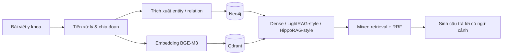

# Vietnamese Medical Hybrid RAG

Đồ án tốt nghiệp xây dựng hệ thống hỏi đáp tri thức **y khoa tiếng Việt trong miền da liễu**, kết hợp tìm kiếm ngữ nghĩa với truy xuất dựa trên đồ thị tri thức.

## Kiến trúc

## Thành phần chính

- **Ingestion:** thu thập, làm sạch và chia đoạn bài viết; trích xuất thực thể và quan hệ theo schema y khoa.
- **Lưu trữ:** Neo4j cho đồ thị tri thức, Qdrant cho vector; embedding bằng `BAAI/bge-m3`.
- **Truy xuất:** Dense, LightRAG-style, HippoRAG-style (entity seeds và Personalized PageRank), và Mixed kết hợp nhiều nhánh.
- **Đánh giá:** benchmark 127 câu hỏi da liễu, so sánh retrieval metrics và tiêu chí trả lời theo hướng RAGAS-style.

**Công nghệ:** Python, Neo4j, Qdrant, BGE-M3, Streamlit, LLM APIs.

## Kết quả nổi bật

| Phương pháp | Recall@10 | nDCG@10 | Faithfulness | Độ trễ truy xuất |
|---|---:|---:|---:|---:|
| Dense | 0.893 | 0.791 | 0.711 | 173 ms |
| LightRAG-style | 0.671 | 0.496 | 0.621 | 2,060 ms |
| HippoRAG-style | 0.897 | **0.805** | 0.719 | 4,518 ms |
| Mixed | **0.905** | 0.795 | **0.742** | 6,826 ms |

Kết quả cho thấy Mixed đạt Recall@10 và faithfulness cao nhất trong benchmark, nhưng có độ trễ lớn; Dense vẫn là baseline nhanh và cạnh tranh. Đồ thị phụ thuộc vào chất lượng trích xuất entity/relation nên chưa thể thay thế truy xuất văn bản.

> Đây là prototype nghiên cứu phục vụ truy xuất thông tin từ tài liệu đã thu thập, không dùng để chẩn đoán hoặc thay thế tư vấn của chuyên gia y tế.
