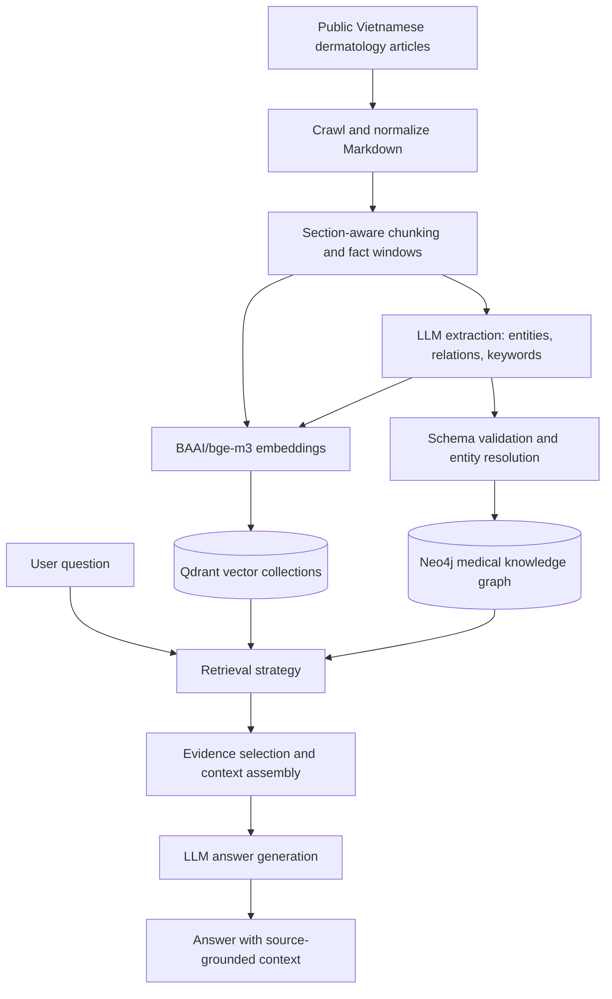

Vietnamese Medical Hybrid RAG
A research prototype for Vietnamese medical question answering in dermatology, developed as a Computer Science undergraduate thesis at Hanoi University of Science and Technology (HUST).
The project studies whether combining semantic vector search with medical knowledge-graph retrieval can improve the evidence returned to a question-answering system. It implements and evaluates four retrieval strategies under the same benchmark rather than assuming that graph-based retrieval is always better.
Scope and safety: This is an academic prototype for retrieving and summarizing information from a collected corpus. It is not a medical device, does not diagnose conditions, and must not be used as a substitute for professional medical advice.

What I built
- Medical document ingestion: Crawling and Markdown normalization for Vietnamese dermatology articles, followed by section-aware chunking and smaller extraction windows.
- Schema-constrained knowledge extraction: LLM-assisted extraction of medical entities, relations, and retrieval keywords; schema validation; entity normalization; and explicit synonym handling.
- Dual storage: Text chunks and embeddings in Qdrant; medical articles, chunks, entities, relations, and their source links in Neo4j.
- Multiple retrieval strategies: A dense-vector baseline, LightRAG-style retrieval, HippoRAG-style graph propagation, and a mixed fusion strategy.
- Answer generation and inspection: Answers are generated from retrieved evidence; a Streamlit interface helps inspect the question, answer, and retrieved context.
- Offline evaluation: Retrieval metrics, rubric-based answer evaluation, difficulty-based summaries, and a manual relation-extraction audit.
Architecture

Retrieval methods
Method	Implementation idea
Dense / Vector	Retrieve text chunks by embedding similarity. This is the fast baseline.
LightRAG-style	Use lower-level keywords to find entity seeds and local relations; use higher-level keywords to retrieve relation records; merge the linked source chunks.
HippoRAG-style	Start from candidate entities and propagate relevance through the knowledge graph, including Personalized PageRank (PPR), to retrieve related evidence.
Mixed	Fuse ranked results from multiple retrieval branches to balance coverage and evidence quality.

These are project implementations inspired by the referenced approaches, adapted to the project's medical schema and Neo4j/Qdrant storage; they are not claimed to be identical to the original frameworks.
Evaluation
The final benchmark contains 127 Vietnamese dermatology questions: 56 easy, 56 medium, and 15 hard. Four retrieval methods were evaluated, for 508 question-method runs. Retrieval metrics are computed over the top 10 results; the answer-generation setup uses the top 5 retrieved chunks as context.
Component	Experimental configuration
Embedding model	BAAI/bge-m3
Vector store	Qdrant
Graph store	Neo4j
Answer generator	gpt-4o-mini
Answer evaluator	gpt-5.4-mini, using a project-specific RAGAS-style rubric

Retrieval results
The table reports the final saved benchmark results. Gold Recall@10 measures recovery of the benchmark's expected evidence/source units in the top 10; nDCG@10 and MRR measure ranking quality. Lower latency is better. Latency is retrieval-only and is specific to the experiment environment.
Method	Gold Recall@10 ↑	nDCG@10 ↑	MRR ↑	Retrieval latency (ms) ↓
Dense / Vector	0.8930	0.7906	0.8178	172.6
LightRAG-style	0.6706	0.4960	0.4959	2,059.7
HippoRAG-style	0.8970	0.8050	0.8297	4,517.9
Mixed	0.9049	0.7949	0.8152	6,826.0

Answer-quality results
The following scores are between 0 and 1 and come from the project's LLM-judge rubric; they are experimental scores, not independently certified clinical-quality measurements.
Method	Faithfulness ↑	Support adequacy ↑	Answer correctness ↑
Dense / Vector	0.7106	0.7375	0.7028
LightRAG-style	0.6205	0.6588	0.6921
HippoRAG-style	0.7194	0.7546	0.6996
Mixed	0.7424	0.7546	0.6925

What the results suggest
- Mixed has the highest overall Gold Recall@10 and faithfulness, but also the highest retrieval latency.
- HippoRAG-style has the best overall nDCG@10 and MRR, and is particularly useful for ranking evidence on harder questions in this benchmark.
- Dense retrieval is a strong baseline: it is substantially faster and has the highest answer-correctness score in the reported experiment.
- LightRAG-style retrieval performs less strongly on this particular corpus. This is a result about this implementation and dataset, not a general conclusion about LightRAG.
The findings highlight a practical trade-off between retrieval coverage, answer grounding, ranking quality, and latency. Graph retrieval is most useful as an additional signal rather than an assumed replacement for a strong vector baseline.
Limitations
- The benchmark is domain-specific and contains only 127 questions, with 15 in the hard subset; hard-question comparisons should therefore be interpreted cautiously.
- A manual audit of relation extraction on 10 articles produced a strict F1 of 0.4384 and a soft-matching F1 of 0.5804. The graph contains useful signals, but extracted relations are not reliable enough to be treated as an authoritative medical knowledge base.
- The answer-quality scores use an LLM judge and a project-specific rubric. They are not clinical validation or a substitute for expert review.
- Full end-to-end reproduction requires the source corpus, prebuilt Neo4j/Qdrant indexes, model access, and API configuration. Those resources are not all bundled with this repository.
Tech stack
Python · Scrapy · BAAI/bge-m3 · Neo4j · Qdrant · OpenAI API / Ollama · Streamlit · pandas · scikit-learn
Repository map
app/
  crawler/          Source-specific article crawling and Markdown conversion
  domain/           Medical entity/relation schema
  ingestion/        Chunking, extraction, validation, resolution, and indexing
  infrastructure/   Embedding, Neo4j, and Qdrant adapters
  retrieval/        Vector, LightRAG-style, HippoRAG-style, and mixed retrieval
  reasoning/        Answer generation and prompt construction
  evaluation/       Benchmark loading, evaluation, and reporting
  ui/               Streamlit question-answering interface
scripts/            Ingestion, evaluation, and audit utilities
data/result/        Selected benchmark summaries and report tables
Demo and local configuration
The Streamlit interface is available at app/ui/streamlit_chat.py. It expects Neo4j and Qdrant to be configured and populated with the corresponding project data; the interface alone does not include the indexed medical corpus.
pip install -r requirements.txt
# Create a local .env from .env.example and set your own service credentials/API keys.
streamlit run app/ui/streamlit_chat.py
Do not commit a real .env, API keys, database credentials, database dumps, or large scraped article bodies. Selected aggregate evaluation tables can be shared without publishing the full source corpus.
References
- Guo et al., LightRAG: Simple and Fast Retrieval-Augmented Generation.
- Gutiérrez et al., HippoRAG: Neurobiologically Inspired Long-Term Memory for Large Language Models.
